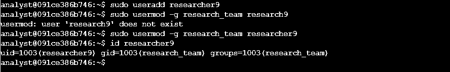
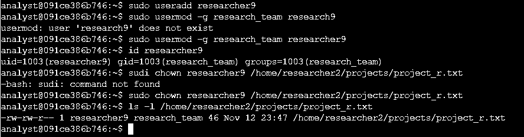
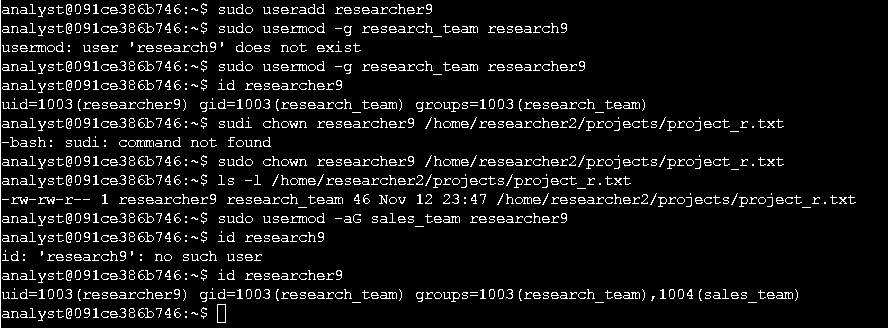
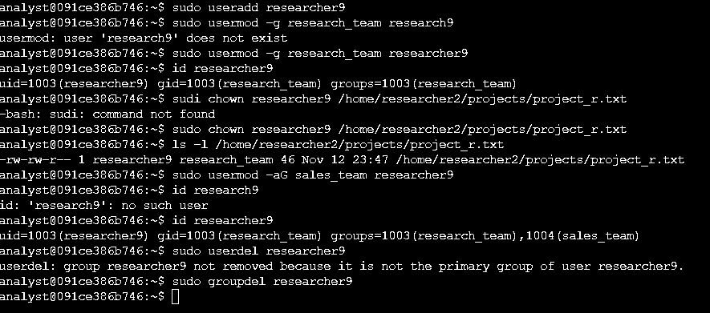

# 👤 Gerenciamento de usuários e grupos no Linux

> Lab prático do **Google Cybersecurity Professional Certificate**: *Add and manage users with Linux commands*

## 📌 Cenário

Sou analista de segurança numa organização e cuido do **ciclo de vida de um usuário**: entrada de um novo funcionário no departamento de Pesquisa, atribuição de responsabilidade sobre um arquivo, mudança de função (passa a atender também Vendas) e, por fim, desligamento.

## 🛠️ Ferramentas e comandos

`Linux (Bash)` · `sudo` · `useradd` · `usermod` · `chown` · `userdel` · `groupdel` · `id` · `ls -l`

---

## Tarefa 1: Adicionar um novo usuário

O funcionário `researcher9` entrou no departamento de Pesquisa. Criei o usuário e defini `research_team` como **grupo principal**.

```bash
sudo useradd researcher9
sudo usermod -g research_team researcher9
id researcher9
# uid=1003(researcher9) gid=1003(research_team) groups=1003(research_team)
```



---

## Tarefa 2: Atribuir a propriedade de um arquivo

O `researcher9` ficou responsável pelo `project_r`. Tornei-o **proprietário** do arquivo, que antes pertencia ao `researcher2`.

```bash
sudo chown researcher9 /home/researcher2/projects/project_r.txt
ls -l /home/researcher2/projects/project_r.txt
# -rw-rw-r-- 1 researcher9 research_team 46 Nov 12 23:47 /home/researcher2/projects/project_r.txt
```



---

## Tarefa 3: Adicionar o usuário a um grupo secundário

Meses depois, o funcionário passou a atuar também em Vendas. Adicionei-o ao `sales_team` como **grupo secundário**, mantendo `research_team` como principal.

```bash
sudo usermod -aG sales_team researcher9
id researcher9
# uid=1003(researcher9) gid=1003(research_team) groups=1003(research_team),1004(sales_team)
```



---

## Tarefa 4: Excluir o usuário

Com o desligamento do funcionário, removi a conta e, em seguida, o grupo `researcher9`, criado automaticamente junto com o usuário e que ficou vazio.

```bash
sudo userdel researcher9
# userdel: group researcher9 not removed because it is not the primary group of user researcher9.
sudo groupdel researcher9
```



---

## 🔐 Por que isso importa em segurança

- **Onboarding e offboarding:** contas de ex-funcionários que continuam ativas são uma das portas de entrada mais comuns em incidentes. Remover o usuário **e** os grupos órfãos reduz a superfície de ataque.
- **Mínimo privilégio:** cada usuário deve ter só os acessos de que precisa. Grupos principais e secundários permitem dar acesso por função (Pesquisa, Vendas) sem permissões individuais soltas.
- **`-aG` e não só `-G`:** sem o `-a` (append), o `usermod -G` **substitui** todos os grupos secundários do usuário. É um erro silencioso, que pode remover acessos legítimos ou deixar permissões inconsistentes.
- **Propriedade de arquivos:** definir corretamente o dono (`chown`) garante responsabilidade e rastreabilidade sobre quem pode alterar um recurso.
- **Visão de SOC:** criação de contas, mudança de grupos (principalmente `sudo`/admin) e exclusão de usuários são eventos que um analista monitora em logs (`/var/log/auth.log`) para identificar persistência ou escalonamento de privilégio.

## 💡 Aprendizados

- Validar sempre o resultado (`id`, `ls -l`) depois de cada alteração, sem assumir que deu certo.
- Errei a digitação em alguns comandos (`research9` em vez de `researcher9`, `sudi` em vez de `sudo`). O próprio sistema avisou (`user does not exist`, `command not found`) e corrigi na hora. **Ler a mensagem de erro é metade da solução.**
- Usuários e grupos são coisas separadas: excluir um usuário não apaga, necessariamente, o grupo dele.
