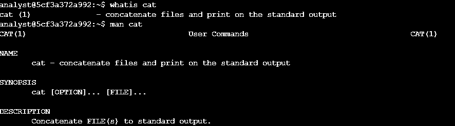
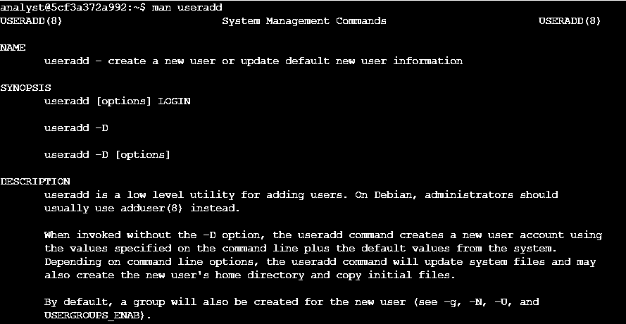
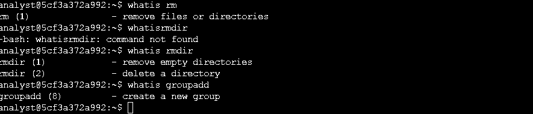

# 📖 Obter ajuda na linha de comando do Linux

> Lab prático do **Google Cybersecurity Professional Certificate**: *Get help in the command line*

## 📌 Cenário

No dia a dia de um analista nem sempre lembro exatamente o que um comando faz ou qual opção usar. Neste lab usei as ferramentas de ajuda **nativas do Linux** para consultar comandos, descobrir opções e encontrar o comando certo a partir de palavras-chave, sem depender de busca na internet.

## 🛠️ Ferramentas e comandos

`Linux (Bash)` · `whatis` · `man` · `apropos`

| Comando | Para que serve |
|---|---|
| `whatis` | Mostra uma descrição de uma linha sobre o comando |
| `man` | Abre o manual completo, com descrição e todas as opções (`Q` para sair) |
| `apropos` | Busca comandos por palavra-chave na descrição dos manuais (`-a` exige todas as palavras) |

---

## Tarefa 1: Saber mais sobre um comando

Revisão rápida do `cat` com `whatis` e, em seguida, o manual completo com `man`. Depois, usei `apropos` para encontrar um comando que mostra só o início de um arquivo.

```bash
whatis cat
# cat (1) - concatenate files and print on the standard output
man cat
apropos -a first part file
```



---

## Tarefa 2: Explorar as opções do `useradd`

Precisava definir uma **data de expiração** para uma conta de usuário temporária. Consultei o manual do `useradd` e encontrei a opção `-e` (`--expiredate`).

```bash
man useradd
```



---

## Tarefas 3 e 4: Comparar `rm` e `rmdir` e descobrir o comando para criar grupos

Com `whatis`, comparei os dois comandos de remoção: o `rmdir` remove **apenas diretórios vazios**, enquanto o `rm` remove arquivos e diretórios. Depois, identifiquei o `groupadd` como o comando para criar um novo grupo.

```bash
whatis rm
# rm (1)       - remove files or directories
whatis rmdir
# rmdir (1)    - remove empty directories
whatis groupadd
# groupadd (8) - create a new group
```



---

## 🔐 Por que isso importa em segurança

- **Autonomia em ambientes isolados:** servidores de produção e máquinas em investigação muitas vezes não têm acesso à internet. Saber usar `man`, `whatis` e `apropos` permite trabalhar com segurança mesmo assim.
- **Contas temporárias com prazo:** a opção `useradd -e` faz contas de terceiros, estagiários ou acessos emergenciais **expirarem sozinhas**, o que evita contas esquecidas e ativas (um risco comum de acesso indevido).
- **Evitar ações destrutivas:** entender a diferença entre `rm` e `rmdir` antes de executar reduz o risco de apagar dados ou evidências por engano.
- **Conferir antes de executar:** consultar a documentação oficial antes de rodar um comando com `sudo` é uma boa prática de segurança operacional.

## 💡 Aprendizados

- `whatis` para uma lembrança rápida, `man` para os detalhes e `apropos` quando não sei o nome do comando.
- Digitei `whatisrmdir` sem espaço e recebi `command not found`. Corrigi para `whatis rmdir`: o espaço separa o comando do argumento.
